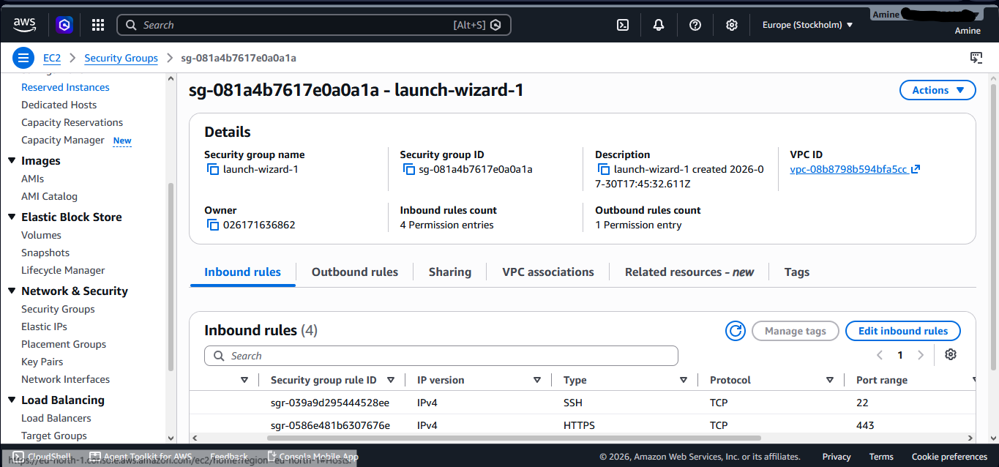
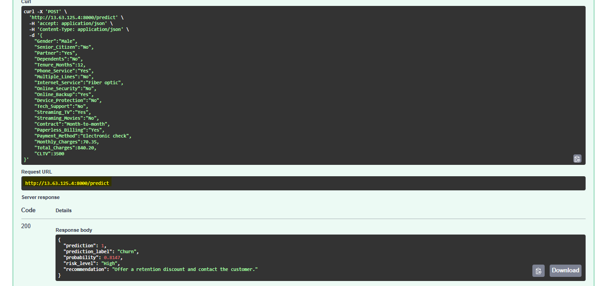
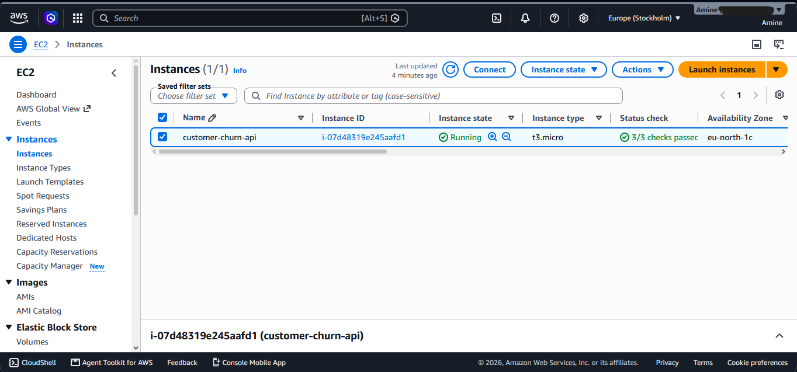
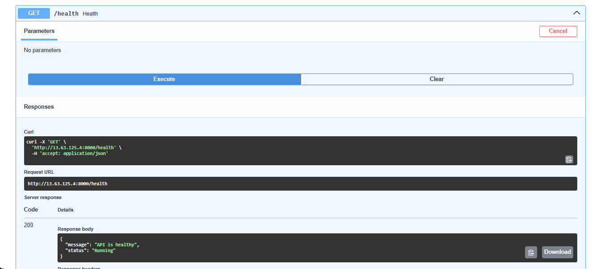

# Customer Churn Prediction API


> An end-to-end ML system: a Random Forest churn model served through **FastAPI**, packaged with **Docker**, tested in **GitHub Actions** CI, and **deployed live on AWS EC2**.

## ☁️ Live on AWS

<table>
  <tr>
    <td width="50%"><p align="center"><b>Interactive API docs (Swagger UI)</b></p></td>
    <td width="50%"><p align="center"><b>Real-time churn prediction</b></p></td>
  </tr>
  <tr>
    <td width="50%"><p align="center"><b>Running on an Ubuntu EC2 instance</b></p></td>
    <td width="50%"><p align="center"><b><code>/health</code> endpoint for monitoring</b></p></td>
  </tr>
</table>

**Deployment flow:** `GitHub → AWS EC2 (Ubuntu) → Docker container → FastAPI (Uvicorn) → REST API on port 8000`

---

#  Overview

This project is an end-to-end Machine Learning application that predicts customer churn using a Random Forest classifier.

The application includes the complete ML workflow:

- Data exploration
- Data preprocessing
- Feature engineering
- Machine Learning pipeline
- REST API with FastAPI
- Docker containerization
- Automated testing
- GitHub Actions CI

The trained model is exposed through a REST API that accepts customer information and returns the churn prediction together with the probability.

---

#  Features

- End-to-End Machine Learning Pipeline
- FastAPI REST API
- Pydantic Request Validation
- Random Forest Classifier
- Docker Support
- Docker Compose
- Unit Testing with Pytest
- GitHub Actions Continuous Integration
- Logging
- Environment Configuration (.env)


---

# Tech Stack

| Category | Technology |
|----------|------------|
| Language | Python |
| Machine Learning | Scikit-Learn |
| API | FastAPI |
| Validation | Pydantic |
| Containerization | Docker |
| CI/CD | GitHub Actions |
| Testing | Pytest |
| Version Control | Git |
| Environment | dotenv |

---

# Project Structure

```text
customer-churn-api/

├── app/
├── training/
├── models/
├── tests/
├── data/
├── Dockerfile
├── docker-compose.yml
├── requirements.txt
├── README.md
└── .github/workflows/
```

---

# Installation

```bash
git clone https://github.com/Med00amine/customer-churn-api.git

cd customer-churn-api

python -m venv .venv

source .venv/bin/activate
```

Windows

```powershell
.venv\Scripts\activate
```

Install dependencies

```bash
pip install -r requirements.txt
```

---

# Running the API

```bash
uvicorn app.main:app --reload
```

Swagger Documentation

```
http://127.0.0.1:8000/docs
```

---

# Docker

Build

```bash
docker build -t customer-churn-api .
```

Run

```bash
docker run -p 8000:8000 customer-churn-api
```

Docker Compose

```bash
docker compose up --build
```

---

# API Endpoints

| Method | Endpoint | Description |
|---------|----------|-------------|
| GET | / | Home |
| GET | /health | Health Check |
| POST | /predict | Predict Customer Churn |

---

# Example Request

```json
{
    "Gender":"Male",
    "Senior_Citizen":"No",
    "Partner":"Yes",
    "Dependents":"No",
    "Tenure_Months":12,
    "Phone_Service":"Yes",
    "Multiple_Lines":"No",
    "Internet_Service":"Fiber optic",
    "Online_Security":"No",
    "Online_Backup":"Yes",
    "Device_Protection":"No",
    "Tech_Support":"No",
    "Streaming_TV":"Yes",
    "Streaming_Movies":"No",
    "Contract":"Month-to-month",
    "Paperless_Billing":"Yes",
    "Payment_Method":"Electronic check",
    "Monthly_Charges":70.35,
    "Total_Charges":840.20,
    "CLTV":3500
}
```

---

# Example Response

```json
{
    "prediction": 1,
    "prediction_label": "Churn",
    "probability": 0.8147,
    "risk_level": "High",
    "recommendation": "Offer a retention discount and contact the customer."
}
```

Risk levels: **High** (probability > 0.7), **Medium** (> 0.4), **Low** otherwise.

Try it with curl:

```bash
curl -X POST http://127.0.0.1:8000/predict   -H "Content-Type: application/json"   -d @sample.json
```

---

# Running Tests

```bash
pytest
```

The test suite checks the `/`, `/health` and `/predict` endpoints against the trained model. Tests run automatically on every push and pull request via GitHub Actions.

---

# Retraining the Model

```bash
python training/train.py
```

This rebuilds the preprocessing + Random Forest pipeline and saves it to `models/Preprocess_RandomForest_Model.pkl`, the path the API loads by default. Override it with the `MODEL_PATH` environment variable (e.g. in `.env`).

# Machine Learning Pipeline

- Data Cleaning
- Feature Engineering
- OneHotEncoder
- StandardScaler
- ColumnTransformer
- Random Forest Classifier
- Scikit-Learn Pipeline

---

# Model Evaluation

Metrics used:

- Accuracy
- Precision
- Recall
- F1 Score
- ROC-AUC

---

# Author

**Mohamed Amine Bouzoffara**

